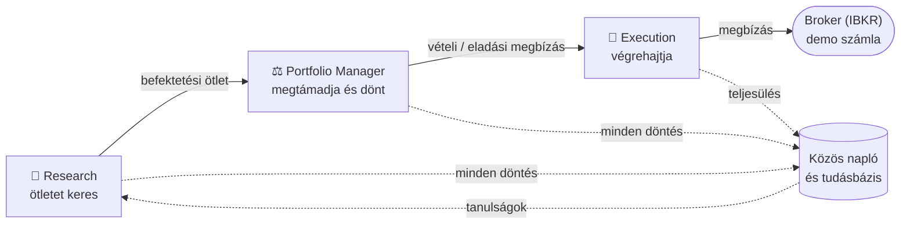
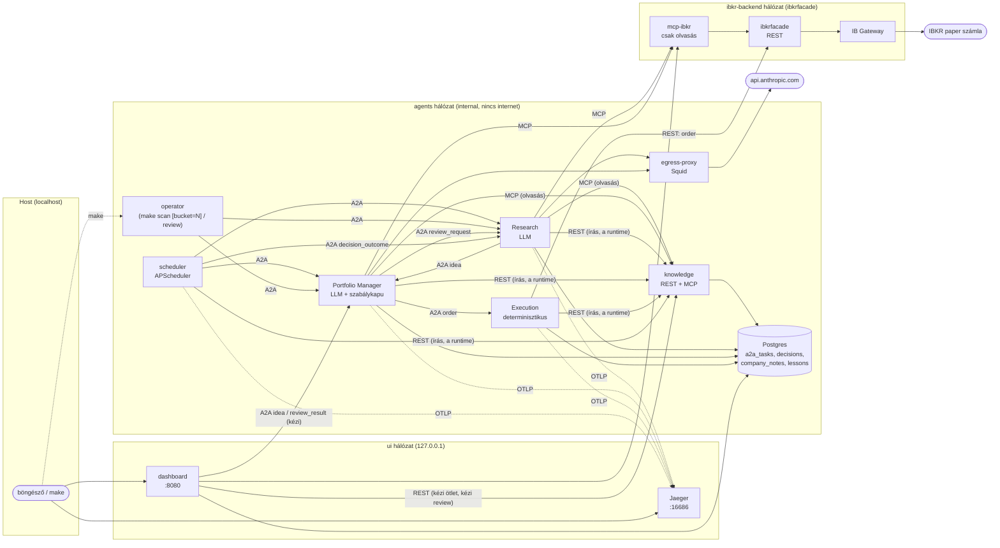
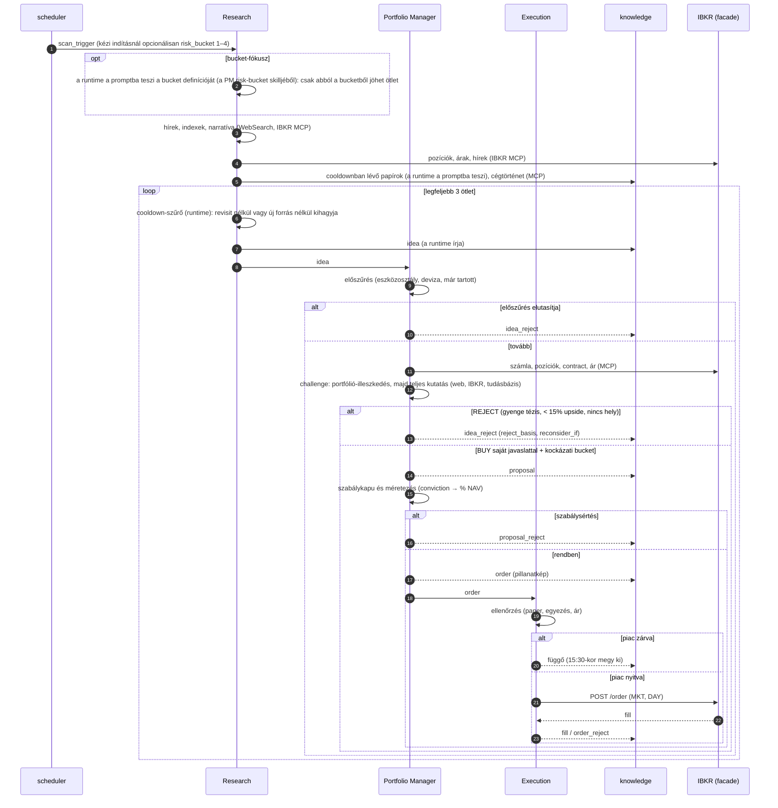
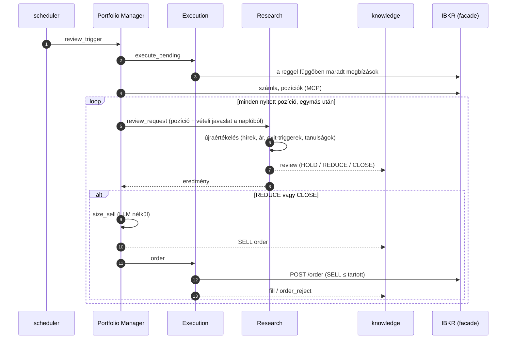
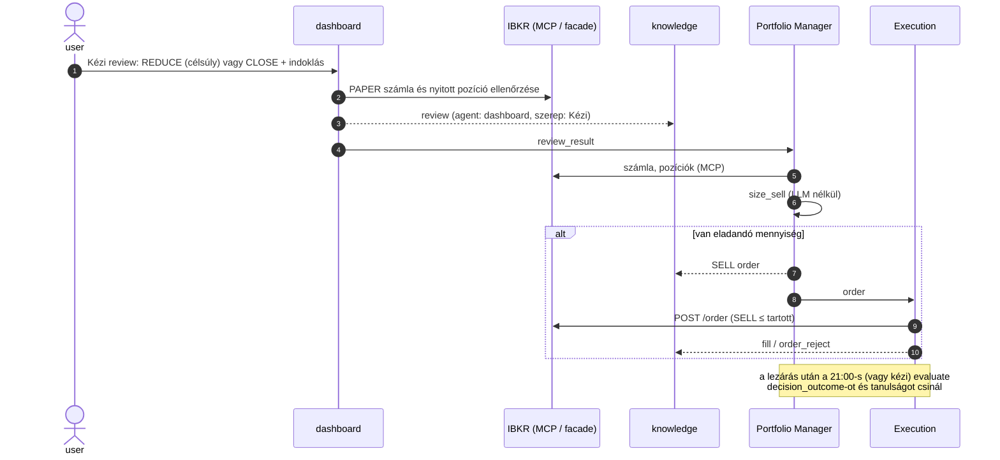
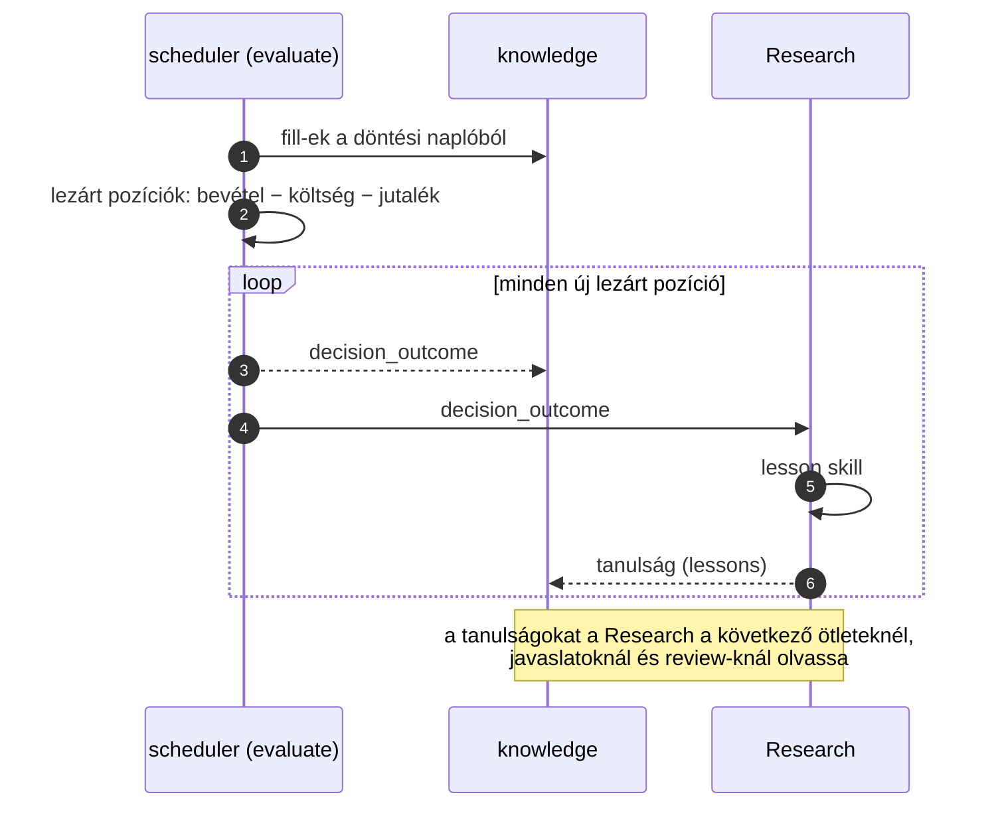
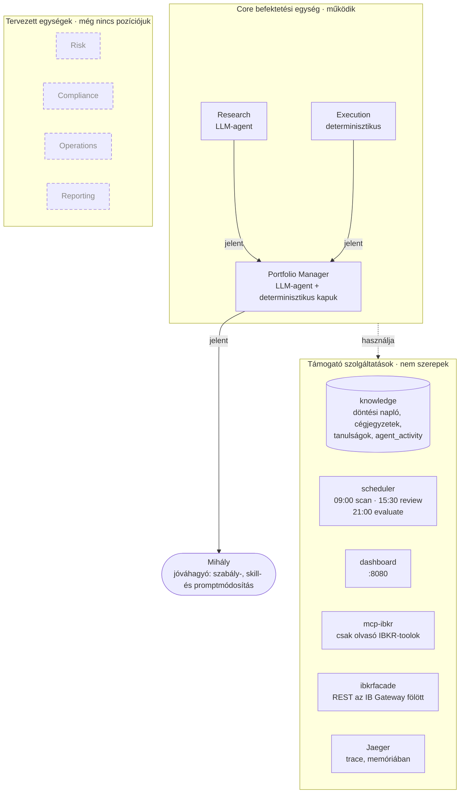
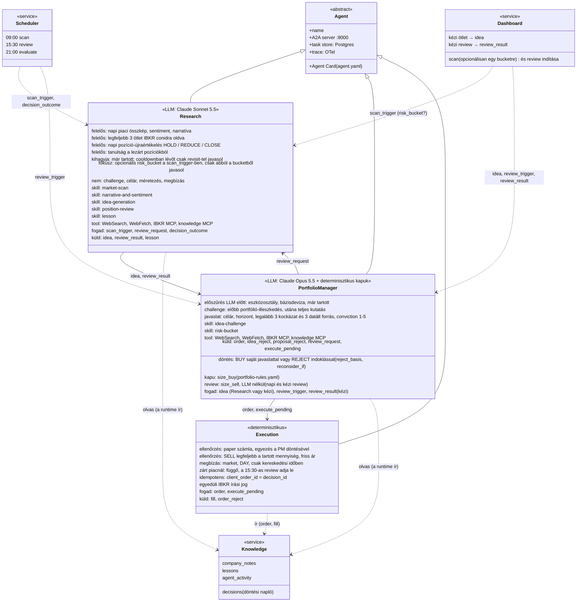
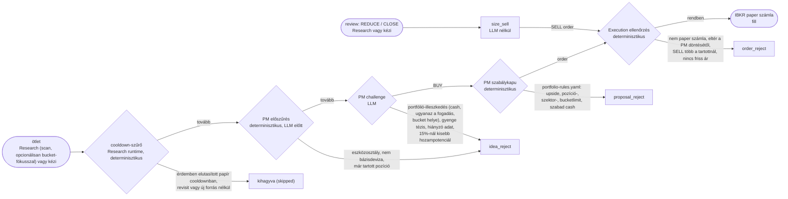

Az Auxin egy **virtuális portfoliokezelő szetvezet, amelyben minden munkatársat egy agent reprezentál**. A projekt célja, nem egy automatizált kereskedési rendszer, hanem egy virtuális szervezet létrehozása volt: pozíciók munkaköri leírással (skillek), írott szabályok, ellenőrzési pontok és közös emlékezet, ahogy egy valódi cégnél.

A kérdés, amire gyakorlati választ keres: **hogyan modellezhetők a szervezeti funkciók AI-ágensekkel?** Egy szervezet értékét a szakértők együttműködése adja; ha a folyamatai végponttól végpontig le vannak írva, ágensekkel gyorsan újraépíthető. A befektetési terület jó próbapálya: szigorúan szabályozott, a döntések mérhetők, és világos, ki mit hagyhat jóvá.

A hagyományos szervezetek belső súrlódásai (hatásköri viták, elveszett tudás, hosszú jóváhagyási láncok) technikai kérdéssé egyszerűsödnek: az átadás egy üzenet, a hatáskör le van írva, a szabály kódban fut, a tudás a naplóban marad. Az ágensek is hibáznak, de a hibáik láthatók és javíthatók.

**[Vezetői összefoglaló](https://claude.ai/artifact/Y4VsYs6N4nfZ2NCP38nKbY)**

> **Fontos:** Ez egy MVP (minimális funkcionalitással, de valóban működő verzió). Csak kísérleti célokat szolgál, anyagi profitszerzés semmilyen formában nem célja.

## Portfolio

Egy portfóliót jelenleg **egyetlen értékpapírszámla reprezentál**: amit a szervezet kezel, az pontosan annak az egy számlának a tartalma (pozíciók, szabad cash, NAV). A portfóliónak nincs külön, a rendszerben vezetett másolata. A számla az igazságforrás, a pozíciókat és a számlaadatokat a rendszer mindig élőben kérdezi le a brokertől.

A rendszer jelenleg az **Interactive Brokers (IBKR)** értékpapírszámláival köthető össze, az [ibkrfacade](https://github.com/medovarszki/ibkrfacade) szolgáltatáson keresztül. Az ibkrfacade egy külön projekt, amely REST felületet ad az IB Gateway fölé, és ott van a paper/live védelem és az idempotens megbízás-leadás is. Az AI-ágensek csak olvasni tudják a számlát (instrumentumkeresés, árfolyam, pozíciók, számlaadatok). Megbízást kizárólag az Execution adhat le. Alapértelmezés szerint a rendszer IBKR paper (demo, `DU…`) számlán fut.

**Saját számla bekötése.** Számlaazonosítót sehol nem kell megadni: azt a számlát kezeli a rendszer, amelyikre az IB Gateway bejelentkezik. A beállítás az ibkrfacade checkoutjának `.env` fájljában van (minta: az ibkrfacade `.env.example`-je), az Auxin `.env`-jébe nem kerül broker-adat:

- `TWS_USERID`, `TWS_PASSWORD`: a saját IBKR **paper** felhasználód belépési adatai (a paper usernek saját felhasználóneve van, ezt az IBKR Client Portalon találod).
- `TRADING_MODE=paper`: maradjon így. Élő számlán az ibkrfacade (`IBKR_ALLOW_LIVE=false`) és az Execution (`DU…` ellenőrzés) is visszautasítja a megbízást.
- `IBKR_SECURITY_ENABLED=false`: az Auxin egyelőre token nélkül hívja az ibkrfacade-et, ezért ezt ki kell kapcsolni (a facade csak a belső `ibkr-backend` hálózaton érhető el).
- `REDIS_PASSWORD`: tetszőleges, hosszú véletlen érték.
- `IBKR_MARKET_DATA_TYPE`: `1` élő árfolyam, `3` késleltetett, ha a paper számlán nincs piaci adat előfizetés.

Ha az ibkrfacade checkout nem a repó mellett (`../ibkrfacade`) van, az útvonalat az `IBKRFACADE_DIR` adja meg: `make IBKRFACADE_DIR=<útvonal> up`. A bekötést a `make ibkr-check` ellenőrzi: megmutatja a számla összesítőjét és egy árfolyamot, megbízást nem ad le.

## Szervezeti áttekintés



| Agent | Kicsoda | Mit csinál |
|---|---|---|
| **Research** | AI-ágens (Claude Sonnet 5.5) | Minden futtatáskor (`scan`) átnézi a piacot: híreket, jegybanki döntéseket, makroadatokat, gyorsjelentéseket, a piaci hangulatot és a domináns narratívákat. Naponta legfeljebb 3 befektetési ötletet küld a PM-nek, datált, ellenőrzött forrásokkal. Délután, a napi felülvizsgálatkor egyenként újraértékeli az összes nyitott pozíciót (tartás, csökkentés vagy zárás); csökkentés vagy zárás esetén eladási megbízás születik. A kiértékeléskor a lezárt pozíciók tényleges hozamából (ezt a rendszer számolja ki) tanulságot ír, amelyet a következő döntéseinél figyelembe vesz. |
| **Portfolio Manager** | AI-ágens (Claude Opus 5.5) + kódba írt szabálykapu | Minden ötletet a portfólió ismeretében megtámad: belefér-e (van-e szabad pénz, nem duplázza-e meg ugyanazt a fogadást, van-e hely az adott kockázati kategóriában), és csak utána kutat. Dönt: **vétel** saját javaslattal (célár, időtáv, kockázatok, források, meggyőződés 1–5) vagy **elutasítás** indoklással. Amit elfogad, abból a kód megbízást méretez. |
| **Execution** | Determinisztikus program, nem AI | Ellenőrzi a megbízást (demo számla-e, egyezik-e a PM döntésével, van-e friss ár), és leadja a brokernél, csak kereskedési időben: zárt piacnál a megbízás függőben marad, és a napi felülvizsgálat elején megy ki. |

Szándékosan **két különböző AI-modell** dolgozik a két ágensben: így az ötletet más „gondolkodásmód” vizsgálja felül, mint amelyik kitalálta.

### Szabályok ("befektetési politika")

- Univerzum: globális részvények és ETF-ek, csak vétel és eladás (long only), horizont: hetektől kb. egy évig. MVP-korlát: csak a számla bázisdevizájában (USD) jegyzett instrumentum (US listing, ADR, US-ETF); nem-US cégnél ADR, nincs FX-átváltás.
- Belépés: új pozíció csak akkor, ha legalább **15% hozampotenciál** van a célárig.
- Méret a meggyőződés (conviction) szerint: 1–5 → 2 / 4 / 6 / 8 / 10% NAV (`position.conviction_weight_pct` a szabályfájlban); új pozíció ≤ 10% NAV; meglévő pozíció nem növelhető (MVP-korlát).
- Szektor (iparág) ≤ 25% NAV (IBKR `industry`, csak részvények; az ETF-ekre szektorlimit nincs).
- Kockázati bucket ≤ 25% NAV bucketenként (részvény és ETF): 1 stabil, 2 mérsékelt, 3 növekedési, 4 spekulatív; a besorolás a PM ítélete, a vételi orderrel a naplóba kerül; a szabály előtt vett pozíció nem számít bele. A kézi scan egy bucketre fókuszálhat (`scan_trigger` payload `risk_bucket`, `make scan bucket=N`, dashboard-választó): a Research ilyenkor csak az abba illő jelöltet javasol, ugyanazzal a definícióval, mint a PM (`risk-bucket` skill `## Buckets` része, a Research image-be másolva); a piaci összkép nem szűkül, és a végleges besorolást továbbra is a PM adja.
- Megbízás: csak szabad cash, nincs tőkeáttétel; market order, DAY; csak paper (`DU…`) számla. Megbízás előtt nincs emberi jóváhagyás (tech demo, paper számla); élő számlánál újra kötelező.
- Review: minden nyitott pozíció minden nap; CLOSE = a teljes pozíció, REDUCE = lefelé kerekítve (jelenlegi súly − cél-súly) × NAV / ár, legalább 1 db. Nincs veszteség-trigger és stop-loss.
- Újrajavaslás (`rejections.revisit`): nincs visszadobási kör, a PM elutasítása végleges, a papír csak új ötletként jöhet újra. Az érdemi elutasítás (`reject_basis: thesis`) 30 napos cooldownt indít az instrumentumra; 60 napon belüli második elutasítás után 60 nap. Cooldownban a Research csak `revisit` blokkal javasolhatja újra (a legutóbbi elutasított ötlet id-ja, mi változott, legalább 1, ismételtnél 2 forrás az elutasítás napja utánról); ennek hiányában a runtime a PM előtt kiszűri (a scan artifactjában `skipped`). Így egy hirtelen fordulat után másnap is visszajöhet, de változatlan piacon nem ismétlődik naponta ugyanaz az ötlet. A PM megkapja az előző elutasítást (`prior_rejection`: ok, `reconsider_if`). Nem indít cooldownt: a determinisztikus előszűrés és a csak adathiány miatti elutasítás (`reject_basis: data`, pl. nincs élő ár). A kézi ötletre a szűrő nem vonatkozik, de a PM azt is az előző elutasításhoz méri.
- Feedback: lezárt egy pozíció, ha az eladások kiadják a vett mennyiséget; hozam = (bevétel − költség − jutalék) / költség, benchmark nélkül.
- Napló és változtatás: minden döntés indoklással együtt a közös naplóba kerül; szabályt, eljárást, skillt vagy ágens-utasítást (promptot) egyelőre csak ember módosíthat, Mihály jóváhagyásával.

Ezeket a szabályokat nem az AI-ra bízzuk, hanem **kód kényszeríti ki**: ha egy döntés sértené valamelyiket, nem lesz belőle megbízás.

### Felületek

A böngészőben futó irányítópulton bárki követheti a szervezet működését:

- **Szervezet:** szervezeti ábra a jelentési vonalakkal, pozíciónként munkaköri leírás (szerep, skillek teljes szöveggel, eszközök, üzenetek, jogosultságok), a döntési jogok mátrixa és a hozzáférések.
- **Politika:** a befektetési szabályok olvasható formában, az élő portfólió limit-kihasználtságával (pozíció, iparág, kockázati kategória, cash), és azzal, melyik ellenőrzési pont kényszeríti ki őket.
- **Portfólió élőben:** vagyon, szabad pénz, pozíciók, súlyok, nyereség/veszteség.
- **Élő nézet:** felül egy futószalag-sáv mutatja, ki dolgozik éppen (Research → PM → Execution), ki adta át a munkát és vár, ki végzett; alatta ágensenként látszik, mit csinál és mit „gondol” éppen az AI (keresések, olvasott források, köztes következtetések).
- **Ötletmenedzser:** minden ötlet, elfogadott és elutasított, kattintható folyamatábrával; egy ötlet teljes története visszajátszható.
- **Agentek nézet:** munkatársanként az elmúlt 7 / 14 / 30 nap: hány feladatot végzett és milyen eredménnyel, milyen döntéseket hozott, mennyi AI-erőforrást használt, mely eszközöket használta a leggyakrabban.
- **Döntési napló, lezárt pozíciók és tanulságok** szűrhető listában.

Az emberi beavatkozás lehetőségei (mind csak a demo számlán):

| Gomb | Mit csinál |
|---|---|
| **▶ Ötletgenerálás** | azonnal elindít egy reggeli piacátnézést, nem kell 9:00-ig várni; mellette választható, melyik kockázati kategóriából (stabil, mérsékelt, növekedési, spekulatív) keressen ötletet |
| **＋ Saját ötlet** | ember is beadhat ötletet; a PM ugyanazzal a szigorral vizsgálja, mint a Research ötleteit |
| **🔍 Minden pozíció review** / pozíciónként **🔍 Review** | azonnal újraértékelteti az összes vagy egy kiválasztott pozíciót |
| **Kézi döntés** | ember dönthet egy pozíció csökkentéséről vagy zárásáról, indoklással; a méretezést és a végrehajtást ugyanúgy a szervezet végzi |

---

# Technikai leírás

- A szerepeket Claude-alapú LLM-agentek (Research: Sonnet 5.5, Portfolio Manager: Opus 5.5) és determinisztikus szolgáltatások töltik be.
- Minden szerep külön Docker containerben fut.
- Az agentek A2A 1.0 protokollon kommunikálnak.
- Minden feladat egy közös Postgres task store-ba kerül, így a működés auditált.
- A döntések közös tudásbázisba íródnak, a tanulási ciklusokhoz.
- A portfóliót jelenleg egyetlen Interactive Brokers **paper** számla reprezentálja.

## Struktúra

| Könyvtár | Mi van benne |
|---|---|
| `org/` | A szervezet deklaratív leírása (`org.yaml`), a befektetési szabályok és az agent-leírók sémája |
| `agents/` | 1 könyvtár = 1 szerep = 1 container: `agent.yaml`, `CLAUDE.md`, saját `skills/`, `Dockerfile` (az Execution determinisztikus, ugyanazzal a runtime-mal) |
| `libs/` | Importált Python kód: sémák és szabályok (`auxin-schemas`), A2A-réteg és tracing (`auxin-a2a`), agent runtime (`auxin-runtime`) |
| `mcp-servers/` | Saját MCP szerverek (IBKR) |
| `services/` | Futó, nem-agent containerek (tudásbázis, scheduler a döntés-kiértékelővel, dashboard) |
| `infra/` | Compose (Jaeger is), egress proxy és allowlist |
| `docs/` | szervezeti terv, feladatmodell |

## Futtatás

Előfeltétel: Docker CE, `make`, `uv`, a repó mellett az [ibkrfacade](https://github.com/medovarszki/ibkrfacade) checkoutja a saját `.env`-jével (`IBKRFACADE_DIR`, alapérték `../ibkrfacade`), és a gyökérben kitöltött `.env` (lásd `.env.example`: `CLAUDE_CODE_OAUTH_TOKEN`, `POSTGRES_PASSWORD`; `ANTHROPIC_API_KEY` ne legyen beállítva).

```
make build && make up      # broker stack, Postgres, tudásbázis, agentek, scheduler, Jaeger, dashboard
make ui                    # dashboard: http://localhost:8080, Jaeger: http://localhost:16686
make down                  # az Auxin leállítása (a broker stacké: make ibkr-down)
```

Kézi indítás és ellenőrzés:

```
make scan                  # egy napi scan (vételi hurok); ugyanez a dashboardon: ▶ Ötletgenerálás, élő nézettel
make scan bucket=3         # scan egy kockázati bucketre fókuszálva (1 stabil … 4 spekulatív): csak onnan jön ötlet
make review                # napi review (függő megbízások, pozíciónkénti újraértékelés, eladás)
make run-job job=evaluate  # egy scheduler-job most (scan | review | evaluate)
make execute-pending       # zárt piac miatt függő megbízások leadása
make tasks                 # a közös task tábla
make decisions             # a döntési napló
make logs                  # JSON-naplók
make ibkr-check            # broker: health, paper számla, egy ár (megbízás nélkül)
make mcp-check             # IBKR MCP toolok (megbízás nélkül)
make kb-check              # tudásbázis: REST, MCP, keresés
make egress-test           # example.com tiltva, api.anthropic.com átmegy
```

## Felületek

### Dashboard (<http://localhost:8080>)

**Szervezet.** A szervezet a leíróiból rajzolva (`GET /api/org`: `org/org.yaml`, `agents/<név>/agent.yaml`, `SKILL.md`, `CLAUDE.md`, `prompts/`; a dashboard image-be másolva, `AUXIN_ORG_ROOT`): szervezeti ábra, pozíció-kártyák (a skillek és promptok teljes szövege kattintásra), döntési jogok (`org.yaml` `decision_rights`), hozzáférések, átadások.

**Politika.** A `portfolio-rules.yaml` szabályonként (`GET /api/policy`): érték, az élő portfólió kihasználtsága a limitekhez képest (a szektor és a kockázati bucket ugyanúgy számolva, mint a PM-kapuban), a kikényszerítő ellenőrzési pont és az általa okozott elutasítások száma.

**Portfólió.** A portfólió élőben, az IBKR-ből: NAV, cash, pozíciók, súly, P&L és az utolsó review. Pozíciónként két művelet érhető el. A **🔍 Review** egyetlen pozíciót értékeltet újra (`review_trigger` `conid`-dal, függő megbízások nélkül). A **Kézi döntés** REDUCE (célsúllyal) vagy CLOSE döntést rögzít indoklással: `review`-ként, `Kézi` szereppel kerül a döntési naplóba, majd `review_result`-ként megy a PM-nek, aki LLM nélkül, a szokásos determinisztikus méretezéssel ad `SELL` megbízást az Executionnek. A lezárás után a `make run-job job=evaluate` csinál belőle tanulságot.

**Indítás.** A **▶ Ötletgenerálás** egy `scan_trigger`-t küld a Researchnek; a mellette lévő választóval (`POST /api/scan?risk_bucket=N`) a scan egy kockázati bucketre fókuszál. A **🔍 Minden pozíció review** egy `review_trigger`-t küld a PM-nek: ez a napi review azonnal, vagyis a függő megbízások, majd minden nyitott pozícióra Research-review, és REDUCE / CLOSE esetén SELL. A **＋ Saját ötlet** kézi ötletet ad be (ticker és tézis, opcionálisan háttér): a dashboard feloldja IBKR conidra, `Kézi` szereppel a döntési naplóba írja, majd `idea`-ként a PM-nek küldi, aki ugyanúgy challenge-eli, mint a Research ötleteit. Minden indítás csak PAPER számlán működik, és egyszerre csak egy folyamat futhat.

**Élő nézet.** Felül a pipeline-sáv (Research → PM → Execution) mutatja, ki dolgozik, ki adta át a munkát és vár, ki végzett; az éleken az átadott ötletek és megbízások látszanak, aktív átadásnál animálva. Alatta agentenként követhető, mit csinál éppen az LLM: keresések, tool-hívások és eredményeik, köztes szöveg és összefoglalt gondolatmenet (az `agent_activity` táblából). Mellette a döntések szerepkör-sávos gráfon jelennek meg, ahogy születnek.

**Ötletek és folyamatok.** Az ötletmenedzser minden generált ötletet listáz (elfogadott / elutasított / folyamatban szűrővel), kattintható folyam-diagrammal; ötletenként a teljes history lejátszható gráfon és szerepkörök szerint is. Külön nézet mutatja a folyamatokat trace szerint, a döntési naplót szűrővel, a taszkokat, a lezárt pozíciókat és a tanulságokat.

**Agentek.** Agentenként, 7 / 14 / 30 napra: taszkok naponta kimenet szerint, taszk-típusok, döntésinapló-események, LLM-token naponta, a leggyakoribb tool-hívások és az utolsó taszkok (`GET /api/agents`).

A dashboard a DB-t csak olvassa. Négy írási művelete van: a scan, a napi review, a kézi ötlet és a kézi review indítása; a döntési naplóba a knowledge REST-en át ír.

### Jaeger (<http://localhost:16686>)

Trace-ek: A2A-hívások, `invoke_agent` (modell, tokenek, turnök), `execute_tool` (WebSearch, MCP), HTTP. A dashboard minden folyamatnál Jaeger-linket ad (ugyanaz a `trace_id`), amíg a Jaeger még tárolja a trace-t.

### CLI

A `make tasks`, `make decisions` és `make logs` a terminálban mutatja a task táblát, a döntési naplót és a JSON-naplókat.

### Belső végpontok

Mindkét webes felület csak a `127.0.0.1`-re publikál, authentikáció nincs. A többi szolgáltatás kívülről nem érhető el:

| Belső végpont | Hálózat | Ki hívja |
|---|---|---|
| `http://<agent>:8000` (A2A JSON-RPC + SSE, Agent Card) | `agents` | agentek, scheduler, operator |
| `http://knowledge:8000` (REST írás, `/mcp` olvasás) | `agents` | runtime, Execution, scheduler, dashboard (kézi ötlet, kézi review) / LLM-agentek |
| `http://mcp-ibkr:8000/mcp` (csak olvasó IBKR-toolok) | `agents`, `ibkr-backend` | LLM-agentek, PM-kapu, dashboard |
| `http://ibkrfacade:8082/ibkr` (REST, írás is) | `ibkr-backend` | csak az MCP szerver és az Execution |
| `postgres:5432` | `agents` | A2A task store, tudásbázis, dashboard (read-only session) |
| `egress-proxy:3128` (Squid) | `agents`, `egress` | LLM-agentek; allowlist: `api.anthropic.com` |

## Architektúra



Fő elvek:
- **Egy szerep = egy container.** Közös, hardenelt base image (non-root, read-only root FS, `cap_drop: ALL`, CPU- és memórialimit), a skillek build-időben az image-be sütve.
- **A broker az igazságforrás.** Pozíció és számla élőben az IBKR-ből jön, tükör-tábla nincs. Írási joga (`ibkr-backend` + ibkrfacade `POST /order`) csak az Executionnek van.
- **Az LLM-ek nem írnak.** A tudásbázisba a runtime ír az agentek strukturált (JSON Schema) kimenetéből; az LLM-ek MCP-n át csak olvasnak.
- **Internet csak a Claude API felé**, a Squid proxyn át, naplózva. A WebSearch szerver-oldali (az Anthropic futtatja).
- **Minden állapot Postgresben.** A2A task store (`a2a_tasks`) és tudásbázis (Alembic-migrációk, full-text keresés).

## Folyamatok

Minden folyamatnak egy `trace_id`-ja van: ez köti össze a task store sorait, a döntési napló bejegyzéseit és a Jaeger-trace-t. Az A2A-ban a címzett nyit új taszkot; a hívás szinkron (a küldő megvárja az eredményt). Timeout: minden taszkra 10 perc. Hiba esetén a taszk `FAILED`, újrapróbálás nincs; a következő ütemezett futás újra előveszi.

### Vétel (munkanapokon 09:00)



### Felülvizsgálat és eladás



### Kézi review (dashboard, bármikor)



### Feedback loop



## Szervezeti modell

Ez a fejezet a szervezet naprakész leírása. Gépileg olvasható megfelelői: [`org/org.yaml`](org/org.yaml) (egységek, pozíciók, jelentési vonalak, döntési jogok), [`org/rules/portfolio-rules.yaml`](org/rules/portfolio-rules.yaml) (befektetési szabályok), `agents/<név>/agent.yaml` (szerepenkénti leíró). Az eredeti, 1. fázisbeli terv: [`docs/ORG.md`](docs/ORG.md).

### Szervezeti ábra



Jelentési vonal: a Research és az Execution a Portfolio Managernek, a PM az embernek (Mihály) jelent. Az ember nem hagy jóvá egyenként megbízást (tech demo, paper számla), csak a szabályok, skillek és promptok módosítását. A tervezett egységek az `org.yaml`-ban már szerepelnek, de még nincs pozíciójuk.

A támogató szolgáltatások nem szerepek, hanem infrastruktúra. A `knowledge` a tudásbázis egyetlen gazdája: REST-en ír, az agenteknek MCP-n csak olvasást ad; az `agent_activity` az élő nézetet szolgálja, best-effort, nem memória. A scheduler `evaluate` jobja a döntés-kiértékelő: a lezárt pozíciók realizált hozamát a fill-ekből számolja (benchmark nélkül), és `decision_outcome`-ként a naplóba és a Researchnek küldi. Az ibkrfacade külön repó, paper/live védelemmel és idempotens orderrel. A Jaeger memóriában tárol, ezért restartkor elvész; az audit forrása a Postgres.

### Pozíciók (UML)



### Ellenőrzési pontok



Minden elutasítás indoklással kerül a döntési naplóba, és végleges (nincs visszadobási kör). A PM érdemi elutasítása cooldownt indít: ezalatt a Research csak azzal javasolhatja újra a papírt, hogy mi változott, az elutasítás utáni forrással; a kihagyott ötlet nem kerül a naplóba, csak a scan taszk eredményébe. A kézi ötlet a cooldown-szűrő kivételével ugyanazokon a kapukon megy át, ugyanazzal a mércével, mint a Research ötletei.
