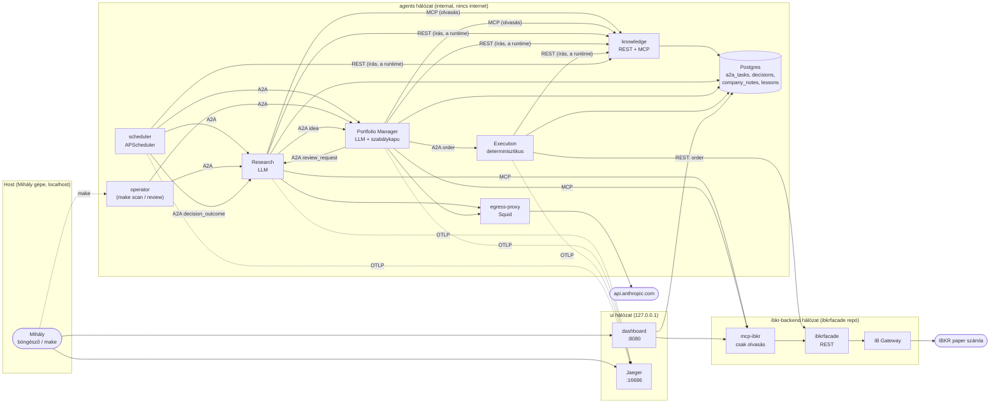
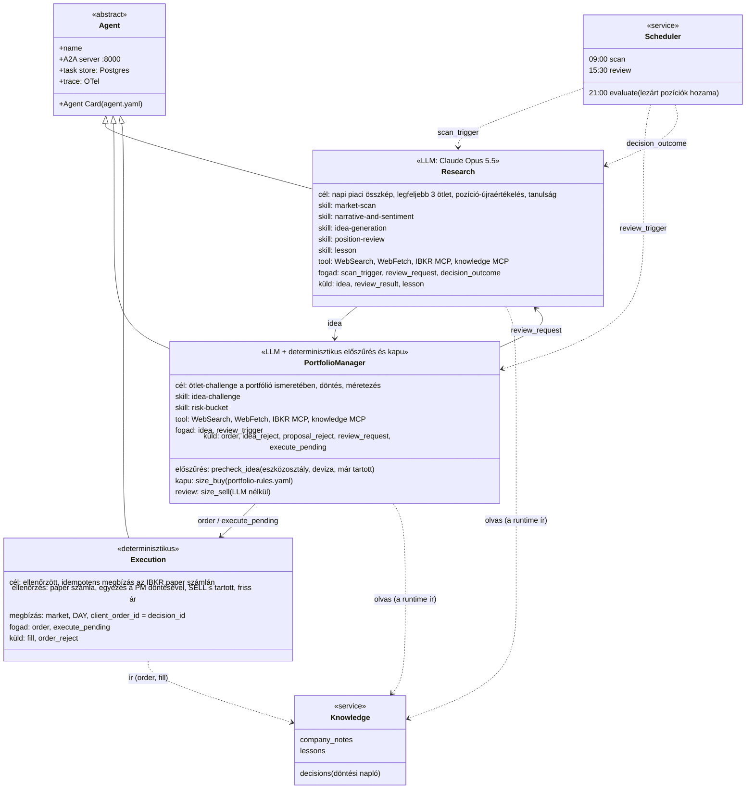
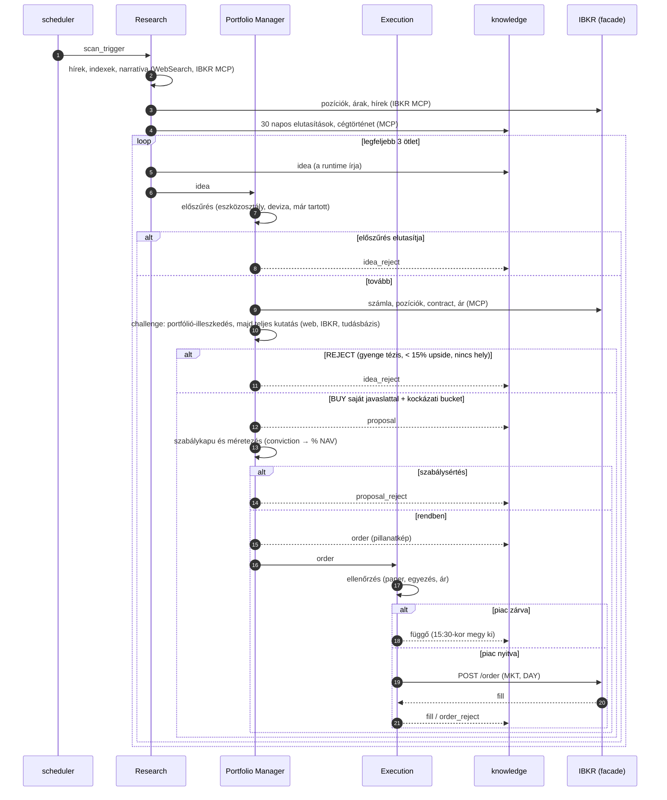
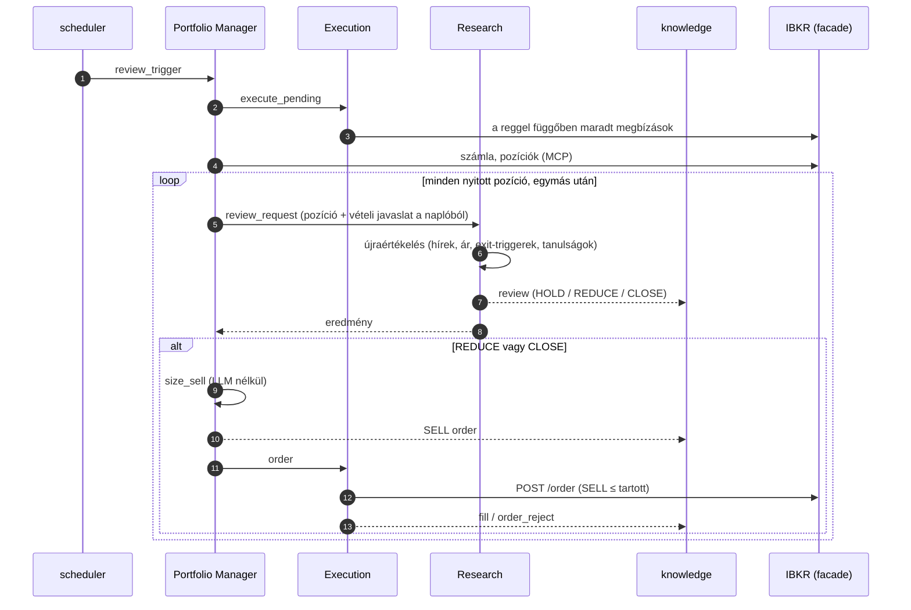
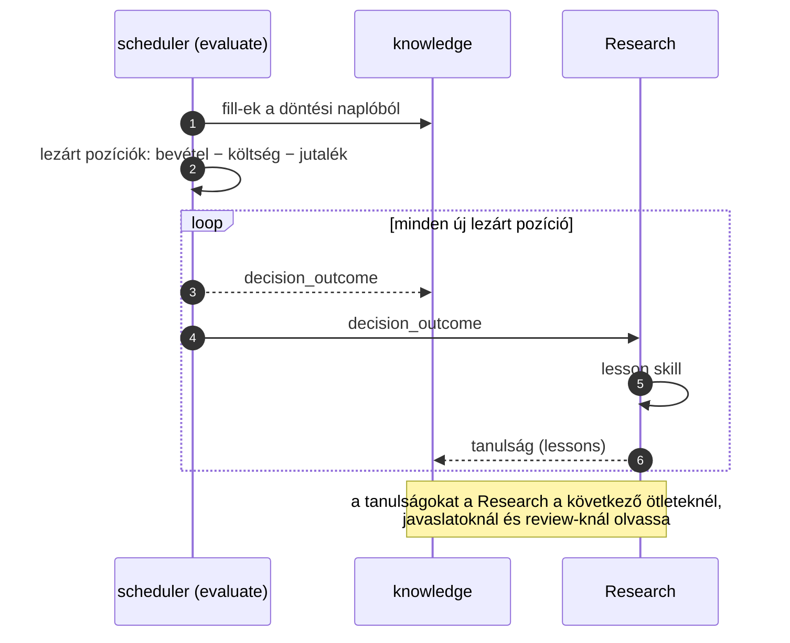
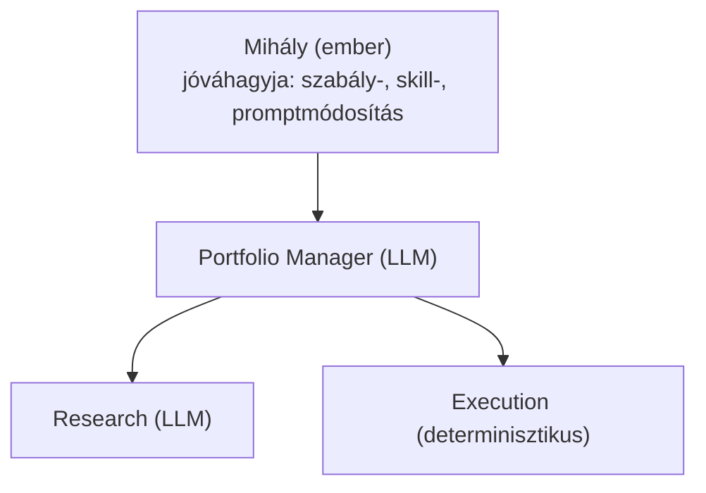

# Auxin – agentic investment organization

Az Auxin **agentekből álló befektetési alapkezelő**, amely egy valódi alapkezelő szervezetét kívánja modellezni: szervezeti egységek, pozíciók, jelentési vonalak, felelősségi körök, írott befektetési szabályok, ellenőrzési pontok és döntési napló. A szerepeket Claude-alapú (Opus) LLM-agentek és determinisztikus szolgáltatások töltik be. Minden szerep külön Docker containerben fut. Az agentek A2A 1.0 protokollon kommunikálnak, minden feladat egy közös Postgres task store-ba kerül, a döntések egy tudásbázisba. A portfólió egyetlen Interactive Brokers **paper** számla.

## Mi készült el

| Fázis | Eredmény | Élesben bizonyítva |
|---|---|---|
| 0–2. Terv | szervezeti terv, szabályfájl, technológiai döntések | – |
| 3. Feladat- és üzenetmodell | A2A 1.0 taszkállapotok, Auxin metaadat-extension, Pydantic-sémák (`libs/auxin-schemas`) | igen |
| 4. Agent-container | közös hardenelt base image, Agent SDK runtime, egress proxy allowlisttel | igen |
| 5. Kommunikáció | minden agent A2A szerver, közös Postgres task store | igen |
| 6.1–6.2 Adat | IBKR MCP szerver (csak olvasás), tudásbázis-szolgáltatás (REST + MCP) | igen |
| 6.3 Vétel | ötlet → PM-challenge és döntés → szabálykapu → paper megbízás | igen: első fill (TSM, 144 db) |
| 6.4 Review és eladás | napi pozíció-újraértékelés, determinisztikus SELL-méretezés | HOLD-ág igen; a SELL-ág még nem futott |
| 6.5 Ütemezés és feedback | scheduler (09:00 / 15:30 / 21:00), lezárt pozíciók kiértékelése, tanulság | ütemezés igen; a tanulság-ág az első zárásnál fut |
| 7. Megfigyelhetőség | dashboard, OTel-trace a Jaegerben (GenAI semconv) | igen |
| 8. Összeállítás és tesztelés | e2e füsttesztek, szándékosan rossz esetek | nincs elkezdve |
| 9. Átvilágítás | biztonsági és pénzügyi checklist, runbook, következő egységek | nincs elkezdve |

## Felületek

| Felület | Cím | Mire való |
|---|---|---|
| **Dashboard** | <http://localhost:8080> | portfólió élőben (NAV, cash, pozíciók, súly, P&L, utolsó review), folyamatok trace szerint részletes idővonallal, döntési napló szűrővel, taszkok, lezárt pozíciók és tanulságok. Csak olvas |
| **Jaeger** | <http://localhost:16686> | trace-ek: A2A-hívások, `invoke_agent` (modell, tokenek, turnök), `execute_tool` (WebSearch, MCP), HTTP. A dashboard minden folyamatnál Jaeger-linket ad (ugyanaz a `trace_id`) |
| CLI | `make tasks`, `make decisions`, `make logs` | a task tábla, a döntési napló és a JSON-naplók a terminálban |

Mindkét webes felület csak a `127.0.0.1`-re publikál, authentikáció nincs. A többi szolgáltatás kívülről nem érhető el:

| Belső végpont | Hálózat | Ki hívja |
|---|---|---|
| `http://<agent>:8000` (A2A JSON-RPC + SSE, Agent Card) | `agents` | agentek, scheduler, operator |
| `http://knowledge:8000` (REST írás, `/mcp` olvasás) | `agents` | runtime, Execution, scheduler / LLM-agentek |
| `http://mcp-ibkr:8000/mcp` (csak olvasó IBKR-toolok) | `agents`, `ibkr-backend` | LLM-agentek, PM-kapu, dashboard |
| `http://ibkrfacade:8082/ibkr` (REST, írás is) | `ibkr-backend` | csak az MCP szerver és az Execution |
| `postgres:5432` | `agents` | A2A task store, tudásbázis, dashboard (read-only session) |
| `egress-proxy:3128` (Squid) | `agents`, `egress` | LLM-agentek; allowlist: `api.anthropic.com` |

## Architektúra



Fő elvek:
- **Egy szerep = egy container.** Közös, hardenelt base image (non-root, read-only root FS, `cap_drop: ALL`, CPU- és memórialimit), a skillek build-időben az image-be sütve.
- **A broker az igazságforrás.** Pozíció és számla élőben az IBKR-ből jön, tükör-tábla nincs. Írási joga (`ibkr-backend` + ibkrfacade `POST /order`) csak az Executionnek van.
- **Az LLM-ek nem írnak.** A tudásbázisba a runtime ír az agentek strukturált (JSON Schema) kimenetéből; az LLM-ek MCP-n át csak olvasnak.
- **Internet csak a Claude API felé**, a Squid proxyn át, naplózva. A WebSearch szerver-oldali (az Anthropic futtatja).
- **Minden állapot Postgresben.** A2A task store (`a2a_tasks`) és tudásbázis (Alembic-migrációk, full-text keresés).

## Az agentek (UML)



## Folyamatok

Minden folyamatnak egy `trace_id`-ja van: ez köti össze a task store sorait, a döntési napló bejegyzéseit és a Jaeger-trace-t. Az A2A-ban a címzett nyit új taszkot; a hívás szinkron (a küldő megvárja az eredményt). Timeout: 60 perc, a `review_trigger`-é 4 óra. Hiba esetén a taszk `FAILED`, újrapróbálás nincs; a következő ütemezett futás újra előveszi.

### Vétel (munkanapokon 09:00)



### Felülvizsgálat és eladás (munkanapokon 15:30)



### Feedback (munkanapokon 21:00)



## Szervezeti modell

Ez a fejezet a szervezet naprakész leírása. Gépileg olvasható megfelelői: [`org/org.yaml`](org/org.yaml) (egységek, pozíciók, jelentési vonalak), [`org/rules/portfolio-rules.yaml`](org/rules/portfolio-rules.yaml) (befektetési szabályok), `agents/<név>/agent.yaml` (szerepenkénti leíró). Az eredeti, 1. fázisbeli terv: [`docs/ORG.md`](docs/ORG.md).

### Egységek

| Egység | Állapot | Pozíciók |
|---|---|---|
| **Core** (befektetési egység) | működik (vétel, napi review és eladás, ütemezés, tanulság) | Research, Portfolio Manager, Execution |
| Risk | tervezett | független kockázatkezelés, limitfelügyelet |
| Compliance | tervezett | szabálymegfelelés, audit |
| Operations | tervezett | elszámolás, egyeztetés a brokerrel |
| Reporting | részben (7.: dashboard, trace) | teljesítményjelentések; a dashboard és a Jaeger támogató szolgáltatás, nem szerep |

### Szervezeti ábra



### Pozíciók

| Pozíció | Típus | Állapot | Felelősség | Fogad | Küld |
|---|---|---|---|---|---|
| **Research** | LLM-agent (2026-10-26 óta egy agent, a korábbi Market & Sentimenttel) | működik | **Ötletek:** napi piaci összkép, sentiment, narratíva; legfeljebb 3 ötlet IBKR conidra oldva, a PM-nek; kihagyja, ami a portfólióban van vagy 30 napon belül elutasított; nem challenge-el, célárat nem ad. **Review:** napi pozíció-újraértékelés (`position-review`: HOLD / REDUCE cél-súllyal / CLOSE). **Tanulság** a lezárt pozíciókból (`lesson`, a runtime írja a `lessons` táblába) | `scan_trigger`, `review_request`, `decision_outcome` | `idea`, `review_result`, `lesson` |
| **Portfolio Manager** | LLM-agent + determinisztikus elő- és szabálykapu | működik | a Research ötleteit a portfólió ismeretében validálja és challenge-eli (`idea-challenge`, 2026-10-26 óta): determinisztikus előszűrés LLM előtt (eszközosztály, bázisdeviza, már tartott), majd először a portfólió-illeszkedés (cash, ugyanaz a fogadás, kockázati bucket helye, emlékezet), csak utána a teljes kutatás (web, IBKR, tudásbázis); BUY saját javaslattal (célár, horizont, ≥3 kockázat, ≥3 datált forrás, conviction 1–5) vagy REJECT; kockázati bucketbe (1–4) sorol (`risk-bucket`); a runtime ellenőrzi a szabályokat és méretez (zárt piacnál az utolsó záróárral); napi review: a runtime a Research javaslatát LLM nélkül hajtja végre (REDUCE / CLOSE → SELL) | `idea`, `review_trigger` | `order`, `idea_reject`, `proposal_reject`, `review_request`, `execute_pending` |
| **Execution** | determinisztikus service | működik | ellenőrzés (paper számla, egyezés a PM döntésével a naplóban, SELL ≤ tartott mennyiség, friss ár), megbízás csak kereskedési időben (zárt piacnál függő, a 15:30-as review adja le), market / DAY, idempotens (`client_order_id = decision_id`); az egyetlen IBKR írási joggal | `order`, `execute_pending` | `fill`, `order_reject` |

### Támogató szolgáltatások (nem szerepek)

| Szolgáltatás | Állapot | Feladat |
|---|---|---|
| `services/knowledge` | működik | a tudásbázis egyetlen gazdája: döntési napló, cégjegyzetek, tanulságok; REST az írásra, MCP (csak olvasás) az agenteknek |
| `mcp-servers/ibkr` | működik | csak olvasó IBKR-toolok (ár, history, hírek, contract, pozíciók, számla) |
| ibkrfacade (külön repó) | működik | REST az IB Gateway fölött; paper/live védelem, idempotens order |
| `services/scheduler` | működik | munkanapokon (hétfő–péntek, Europe/Budapest) 09:00 scan, 15:30 review, 21:00 kiértékelés; kézzel: `make run-job job=...` |
| döntés-kiértékelő (a scheduler `evaluate` jobja) | működik | a lezárt pozíciók realizált hozama a fill-ekből (benchmark nélkül) → `decision_outcome` a naplóba és a Researchnek |
| `services/dashboard` | működik | `localhost:8080`, lásd [Felületek](#felületek) |
| Jaeger (trace) | működik | `localhost:16686`, memóriában (restartkor elvész; az audit a Postgres) |

### Befektetési szabályok (röviden)

- Univerzum: globális részvények és ETF-ek, long only, egyelőre USD-ben jegyzett instrumentumokon át (US listing, ADR, US-ETF); horizont: hetektől kb. egy évig.
- Belépés: legalább 15% hozampotenciál a célárig.
- Méret conviction szerint: 1–5 → 2 / 4 / 6 / 8 / 10% NAV; új pozíció ≤ 10% NAV.
- Szektor ≤ 25% NAV (IBKR `industry`, csak részvények; az ETF-ekre szektorlimit nincs).
- Kockázati bucket ≤ 25% NAV bucketenként (részvény és ETF): 1 stabil, 2 mérsékelt, 3 növekedési, 4 spekulatív; a besorolás a PM ítélete, a vételi orderrel a naplóba kerül; a szabály előtt vett pozíció nem számít bele.
- Csak szabad cash, nincs tőkeáttétel; market order, DAY; csak paper (`DU…`) számla.
- Review: minden nyitott pozíció minden nap; CLOSE = a teljes pozíció, REDUCE = lefelé kerekítve (jelenlegi súly − cél-súly) × NAV / ár, legalább 1 db. Nincs veszteség-trigger és stop-loss.
- Feedback: lezárt egy pozíció, ha az eladások kiadják a vett mennyiséget; hozam = (bevétel − költség − jutalék) / költség, benchmark nélkül. Szabály-, skill- vagy promptmódosítást csak Mihály hagy jóvá.
- MVP-korlátok: csak a számla bázisdevizájában (USD) jegyzett instrumentum, nem-US cégnél ADR (nincs FX-átváltás), meglévő pozíció nem növelhető, nincs visszadobási kör (az elutasítás végleges).
- Megbízás előtt nincs emberi jóváhagyás (tech demo, paper számla); élő számlánál újra kötelező.

### Ellenőrzési pontok

| Ki | Mit dobhat vissza | Mi alapján |
|---|---|---|
| PM előszűrés (determinisztikus, LLM előtt) | Research ötletét | eszközosztály, nem bázisdeviza, már tartott pozíció |
| Portfolio Manager (LLM, challenge) | Research ötletét | portfólió-illeszkedés (cash, ugyanaz a fogadás, kockázati bucket helye), gyenge tézis, hiányzó adat, < 15% hozampotenciál; indoklással |
| PM szabálykapu (determinisztikus) | a PM döntését | `portfolio-rules.yaml`: upside, pozíció-, szektor-, bucketlimit, szabad cash; bázisdeviza, már tartott pozíció |
| Execution (determinisztikus) | megbízást | nem paper számla, eltér a PM döntésétől, SELL több a tartottnál, nincs friss ár |

## Struktúra

| Könyvtár | Mi van benne |
|---|---|
| `org/` | A szervezet deklaratív leírása (`org.yaml`), a befektetési szabályok és az agent-leírók sémája |
| `agents/` | 1 könyvtár = 1 szerep = 1 container: `agent.yaml`, `CLAUDE.md`, saját `skills/`, `Dockerfile` (az Execution determinisztikus, ugyanazzal a runtime-mal) |
| `libs/` | Importált Python kód: sémák és szabályok (`auxin-schemas`), A2A-réteg és tracing (`auxin-a2a`), agent runtime (`auxin-runtime`) |
| `mcp-servers/` | Saját MCP szerverek (IBKR) |
| `services/` | Futó, nem-agent containerek (tudásbázis, scheduler a döntés-kiértékelővel, dashboard) |
| `infra/` | Compose (Jaeger is), egress proxy és allowlist |
| `docs/` | szervezeti terv, feladatmodell |

## Futtatás

Előfeltétel: Docker CE, `make`, `uv`, a repó mellett az [ibkrfacade](https://github.com/medovarszki/ibkrfacade) checkoutja a saját `.env`-jével (`IBKRFACADE_DIR`, alapérték `../ibkrfacade`), és a gyökérben kitöltött `.env` (lásd `.env.example`: `CLAUDE_CODE_OAUTH_TOKEN`, `POSTGRES_PASSWORD`; `ANTHROPIC_API_KEY` ne legyen beállítva).

```
make build && make up      # broker stack, Postgres, tudásbázis, agentek, scheduler, Jaeger, dashboard
make ui                    # dashboard: http://localhost:8080, Jaeger: http://localhost:16686
make down                  # az Auxin leállítása (a broker stacké: make ibkr-down)
```

Kézi indítás és ellenőrzés:

```
make scan                  # egy napi scan (vételi hurok)
make review                # napi review (függő megbízások, pozíciónkénti újraértékelés, eladás)
make run-job job=evaluate  # egy scheduler-job most (scan | review | evaluate)
make execute-pending       # zárt piac miatt függő megbízások leadása
make tasks                 # a közös task tábla
make decisions             # a döntési napló
make logs                  # JSON-naplók
make ibkr-check            # broker: health, paper számla, egy ár (megbízás nélkül)
make mcp-check             # IBKR MCP toolok (megbízás nélkül)
make kb-check              # tudásbázis: REST, MCP, keresés
make egress-test           # example.com tiltva, api.anthropic.com átmegy
```
