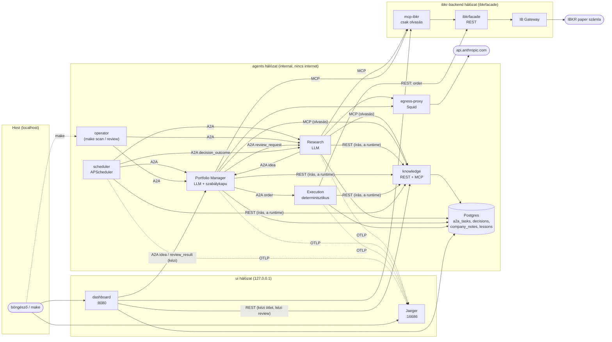
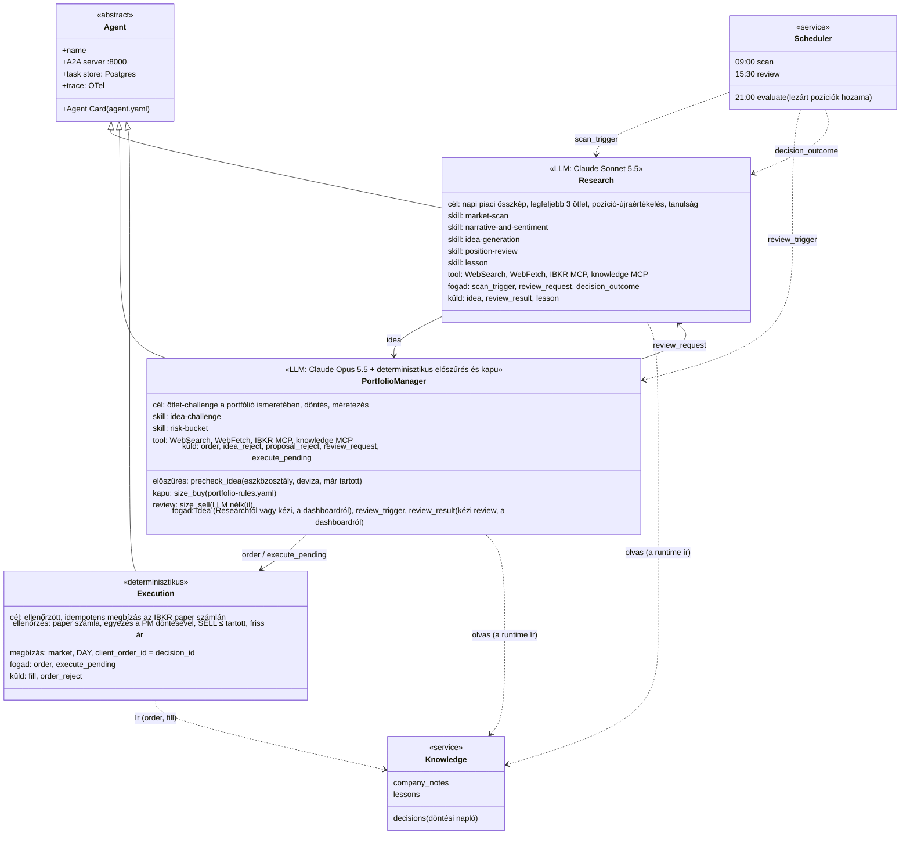
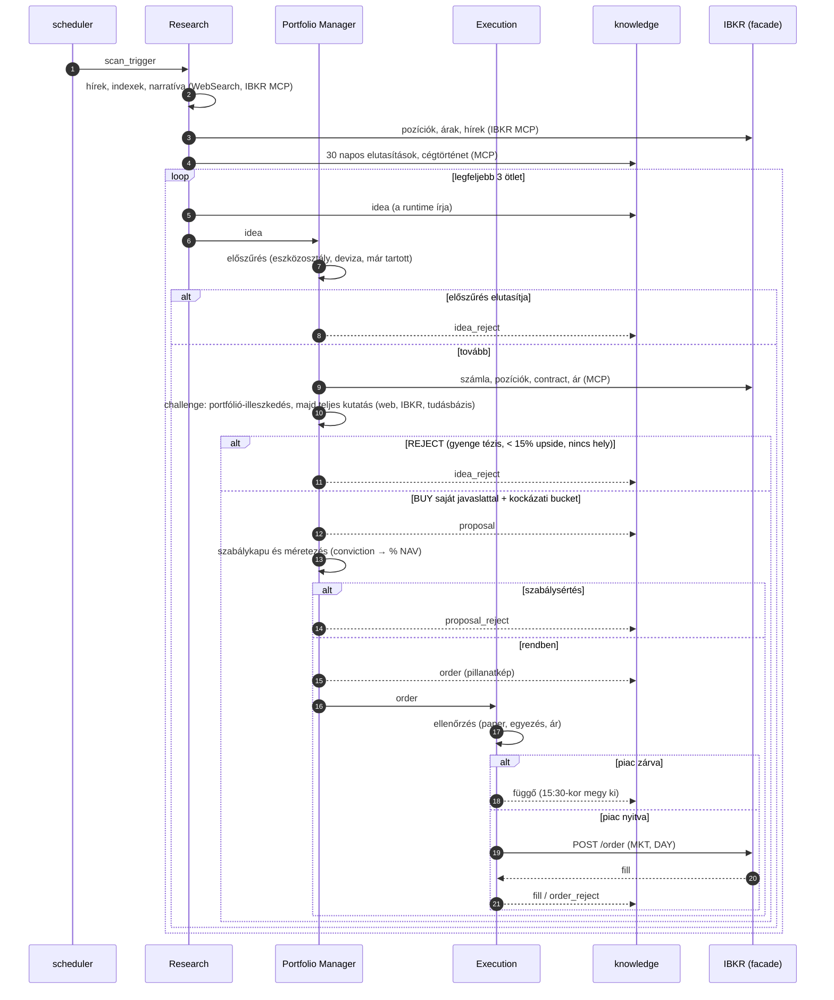
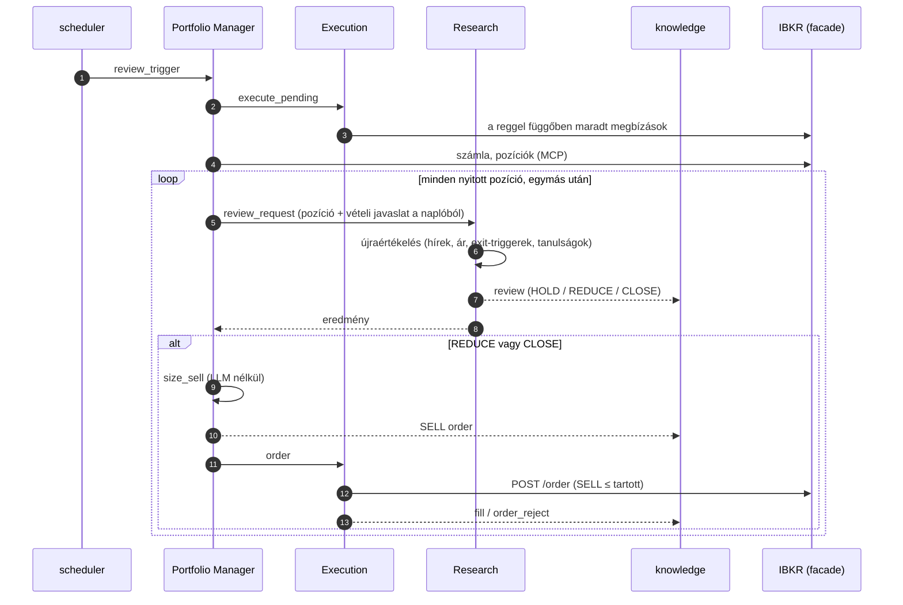
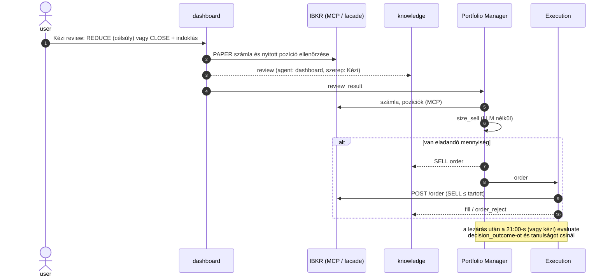
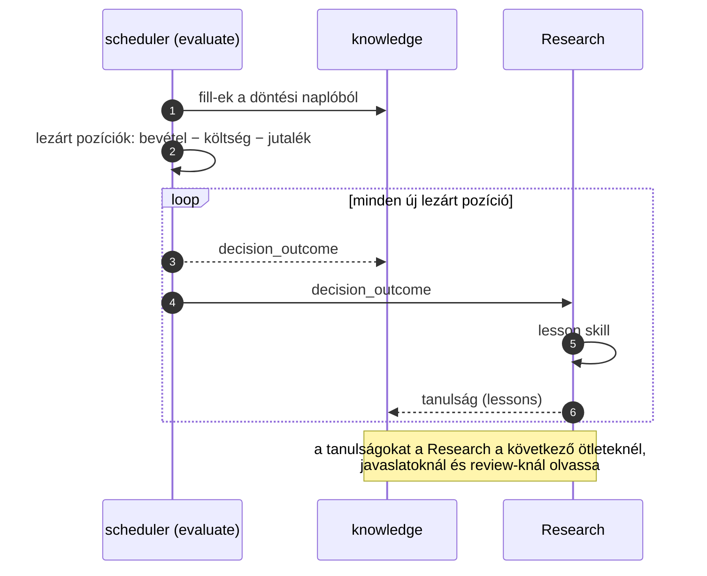

# Auxin – agentic investment organization

Az Auxin egy **kizárólag agentekből álló, virtuális befektetési alapkezelő**, amely egy valódi alapkezelő szervezetét kívánja modellezni: szervezeti egységek, pozíciók, jelentési vonalak, felelősségi körök, írott befektetési szabályok, ellenőrzési pontok és döntési napló.
- A szerepeket Claude-alapú LLM-agentek (Research: Sonnet 5.5, Portfolio Manager: Opus 5.5) és determinisztikus szolgáltatások töltik be.
- Minden szerep külön Docker containerben fut.
- Az agentek A2A 1.0 protokollon kommunikálnak.
- Minden feladat egy közös Postgres task store-ba kerül, így a működés auditált.
- A döntések közös tudásbázisba íródnak, a későbbi tanulási ciklusok lehetősége miatt.
- A portfóliót jelenleg egyetlen Interactive Brokers **paper** számla reprezentálja.

## Struktúra

| Könyvtár | Mi van benne |
|---|---|
| `org/` | A szervezet deklaratív leírása (`org.yaml`), a befektetési szabályok és az agent-leírók sémája |
| `agents/` | 1 könyvtár = 1 szerep = 1 container: `agent.yaml`, `CLAUDE.md`, saját `skills/`, `Dockerfile` (az Execution determinisztikus, ugyanazzal a runtime-mal) |
| `libs/` | Importált Python kód: sémák és szabályok (`auxin-schemas`), A2A-réteg és tracing (`auxin-a2a`), agent runtime (`auxin-runtime`) |
| `mcp-servers/` | Saját MCP szerverek (IBKR) |
| `services/` | Futó, nem-agent containerek (tudásbázis, scheduler a döntés-kiértékelővel, dashboard) |
| `infra/` | Compose (Jaeger is), egress proxy és allowlist |
| `docs/` | szervezeti terv, feladatmodell |

## Futtatás

Előfeltétel: Docker CE, `make`, `uv`, a repó mellett az [ibkrfacade](https://github.com/medovarszki/ibkrfacade) checkoutja a saját `.env`-jével (`IBKRFACADE_DIR`, alapérték `../ibkrfacade`), és a gyökérben kitöltött `.env` (lásd `.env.example`: `CLAUDE_CODE_OAUTH_TOKEN`, `POSTGRES_PASSWORD`; `ANTHROPIC_API_KEY` ne legyen beállítva).

```
make build && make up      # broker stack, Postgres, tudásbázis, agentek, scheduler, Jaeger, dashboard
make ui                    # dashboard: http://localhost:8080, Jaeger: http://localhost:16686
make down                  # az Auxin leállítása (a broker stacké: make ibkr-down)
```

Kézi indítás és ellenőrzés:

```
make scan                  # egy napi scan (vételi hurok); ugyanez a dashboardon: ▶ Ötletgenerálás, élő nézettel
make review                # napi review (függő megbízások, pozíciónkénti újraértékelés, eladás)
make run-job job=evaluate  # egy scheduler-job most (scan | review | evaluate)
make execute-pending       # zárt piac miatt függő megbízások leadása
make tasks                 # a közös task tábla
make decisions             # a döntési napló
make logs                  # JSON-naplók
make ibkr-check            # broker: health, paper számla, egy ár (megbízás nélkül)
make mcp-check             # IBKR MCP toolok (megbízás nélkül)
make kb-check              # tudásbázis: REST, MCP, keresés
make egress-test           # example.com tiltva, api.anthropic.com átmegy
```

## Felületek

| Felület | Cím | Mire való |
|---|---|---|
| **Dashboard** | <http://localhost:8080> | portfólió élőben (NAV, cash, pozíciók, súly, P&L, utolsó review); **▶ Ötletgenerálás** gomb (egy `scan_trigger` a Researchnek, csak PAPER számlán, egyszerre egy), **🔍 Minden pozíció review** (egy `review_trigger` a PM-nek: a napi review azonnal, vagyis függő megbízások, majd minden nyitott pozícióra Research-review, REDUCE / CLOSE → SELL) és pozíciónként **🔍 Review** a portfólió nézetben (ugyanez egyetlen pozícióra: `review_trigger` `conid`-dal, függő megbízások nélkül; PAPER, egyszerre egy folyamat), **＋ Saját ötlet** (kézi ötlet: ticker + tézis, opcionálisan háttér; a dashboard feloldja az IBKR conidra, a döntési naplóba írja `Kézi` szereppel, majd `idea`-ként a PM-nek küldi, aki ugyanúgy challenge-eli, mint a Research ötleteit; PAPER, egyszerre egy folyamat) **Kézi döntés** (pozíciónként a portfólió nézetben: REDUCE célsúllyal vagy CLOSE, indoklással; a döntési naplóba `review`-ként kerül `Kézi` szereppel, majd `review_result`-ként a PM-nek megy, aki a szokásos determinisztikus méretezéssel `SELL` megbízást ad az Executionnek, LLM nélkül; PAPER, egyszerre egy folyamat; a lezárás után a `make run-job job=evaluate` tanulságot csinál) és **élő nézet**: felül a pipeline-sáv (Research → PM → Execution: ki dolgozik, ki adta át és vár, ki kész; az éleken az átadott ötletek / megbízások, aktív átadásnál animálva), alatta agentenként mit csinál éppen az LLM (keresések, tool-hívások és eredményeik, köztes szöveg, az `agent_activity` táblából), a döntések szerepkör-sávos gráfon, ahogy születnek; ötletmenedzser (minden generált ötlet, elfogadott / elutasított / folyamatban szűrővel, kattintható folyam-diagrammal; ötletenként a teljes history lejátszható gráfon és szerepkörök szerint); folyamatok trace szerint, döntési napló szűrővel, **Agentek** nézet (agentenként, 7 / 14 / 30 napra: taszkok naponta kimenet szerint, taszk-típusok, döntésinapló-események, LLM-token naponta és leggyakoribb tool-hívások, utolsó taszkok; `GET /api/agents`), taszkok, lezárt pozíciók és tanulságok. Négy írási művelete a scan, a napi review, a kézi ötlet és a kézi review indítása (a döntési naplóba a knowledge REST-en át ír), a DB-t csak olvassa |
| **Jaeger** | <http://localhost:16686> | trace-ek: A2A-hívások, `invoke_agent` (modell, tokenek, turnök), `execute_tool` (WebSearch, MCP), HTTP. A dashboard minden folyamatnál Jaeger-linket ad (ugyanaz a `trace_id`) |
| CLI | `make tasks`, `make decisions`, `make logs` | a task tábla, a döntési napló és a JSON-naplók a terminálban |

Mindkét webes felület csak a `127.0.0.1`-re publikál, authentikáció nincs. A többi szolgáltatás kívülről nem érhető el:

| Belső végpont | Hálózat | Ki hívja |
|---|---|---|
| `http://<agent>:8000` (A2A JSON-RPC + SSE, Agent Card) | `agents` | agentek, scheduler, operator |
| `http://knowledge:8000` (REST írás, `/mcp` olvasás) | `agents` | runtime, Execution, scheduler, dashboard (kézi ötlet, kézi review) / LLM-agentek |
| `http://mcp-ibkr:8000/mcp` (csak olvasó IBKR-toolok) | `agents`, `ibkr-backend` | LLM-agentek, PM-kapu, dashboard |
| `http://ibkrfacade:8082/ibkr` (REST, írás is) | `ibkr-backend` | csak az MCP szerver és az Execution |
| `postgres:5432` | `agents` | A2A task store, tudásbázis, dashboard (read-only session) |
| `egress-proxy:3128` (Squid) | `agents`, `egress` | LLM-agentek; allowlist: `api.anthropic.com` |

## Architektúra



Fő elvek:
- **Egy szerep = egy container.** Közös, hardenelt base image (non-root, read-only root FS, `cap_drop: ALL`, CPU- és memórialimit), a skillek build-időben az image-be sütve.
- **A broker az igazságforrás.** Pozíció és számla élőben az IBKR-ből jön, tükör-tábla nincs. Írási joga (`ibkr-backend` + ibkrfacade `POST /order`) csak az Executionnek van.
- **Az LLM-ek nem írnak.** A tudásbázisba a runtime ír az agentek strukturált (JSON Schema) kimenetéből; az LLM-ek MCP-n át csak olvasnak.
- **Internet csak a Claude API felé**, a Squid proxyn át, naplózva. A WebSearch szerver-oldali (az Anthropic futtatja).
- **Minden állapot Postgresben.** A2A task store (`a2a_tasks`) és tudásbázis (Alembic-migrációk, full-text keresés).

## Az agentek (UML)



## Folyamatok

Minden folyamatnak egy `trace_id`-ja van: ez köti össze a task store sorait, a döntési napló bejegyzéseit és a Jaeger-trace-t. Az A2A-ban a címzett nyit új taszkot; a hívás szinkron (a küldő megvárja az eredményt). Timeout: 60 perc, a `review_trigger`-é 4 óra. Hiba esetén a taszk `FAILED`, újrapróbálás nincs; a következő ütemezett futás újra előveszi.

### Vétel (munkanapokon 09:00)



### Felülvizsgálat és eladás (munkanapokon 15:30)



### Kézi review (dashboard, bármikor)



### Feedback (munkanapokon 21:00)



## Szervezeti modell

Ez a fejezet a szervezet naprakész leírása. Gépileg olvasható megfelelői: [`org/org.yaml`](org/org.yaml) (egységek, pozíciók, jelentési vonalak), [`org/rules/portfolio-rules.yaml`](org/rules/portfolio-rules.yaml) (befektetési szabályok), `agents/<név>/agent.yaml` (szerepenkénti leíró). Az eredeti, 1. fázisbeli terv: [`docs/ORG.md`](docs/ORG.md).

### Pozíciók

| Pozíció | Típus | Állapot | Felelősség | Fogad | Küld |
|---|---|---|---|---|---|
| **Research** | LLM-agent (2026-10-26 óta egy agent, a korábbi Market & Sentimenttel) | működik | **Ötletek:** napi piaci összkép, sentiment, narratíva; legfeljebb 3 ötlet IBKR conidra oldva, a PM-nek; kihagyja, ami a portfólióban van vagy 30 napon belül elutasított; nem challenge-el, célárat nem ad. **Review:** napi pozíció-újraértékelés (`position-review`: HOLD / REDUCE cél-súllyal / CLOSE). **Tanulság** a lezárt pozíciókból (`lesson`, a runtime írja a `lessons` táblába) | `scan_trigger`, `review_request`, `decision_outcome` | `idea`, `review_result`, `lesson` |
| **Portfolio Manager** | LLM-agent + determinisztikus elő- és szabálykapu | működik | a Research ötleteit a portfólió ismeretében validálja és challenge-eli (`idea-challenge`, 2026-10-26 óta): determinisztikus előszűrés LLM előtt (eszközosztály, bázisdeviza, már tartott), majd először a portfólió-illeszkedés (cash, ugyanaz a fogadás, kockázati bucket helye, emlékezet), csak utána a teljes kutatás (web, IBKR, tudásbázis); BUY saját javaslattal (célár, horizont, ≥3 kockázat, ≥3 datált forrás, conviction 1–5) vagy REJECT; kockázati bucketbe (1–4) sorol (`risk-bucket`); a runtime ellenőrzi a szabályokat és méretez (zárt piacnál az utolsó záróárral); napi review: a runtime a Research javaslatát LLM nélkül hajtja végre (REDUCE / CLOSE → SELL); kézi review (`review_result` a dashboardról): ugyanaz a méretezés és megbízás egy pozícióra, LLM nélkül | `idea` (Researchtől, vagy kézi ötletként a dashboardról: `origin: manual`), `review_trigger`, `review_result` (kézi) | `order`, `idea_reject`, `proposal_reject`, `review_request`, `execute_pending` |
| **Execution** | determinisztikus service | működik | ellenőrzés (paper számla, egyezés a PM döntésével a naplóban, SELL ≤ tartott mennyiség, friss ár), megbízás csak kereskedési időben (zárt piacnál függő, a 15:30-as review adja le), market / DAY, idempotens (`client_order_id = decision_id`); az egyetlen IBKR írási joggal | `order`, `execute_pending` | `fill`, `order_reject` |

### Támogató szolgáltatások (nem szerepek)

| Szolgáltatás | Állapot | Feladat |
|---|---|---|
| `services/knowledge` | működik | a tudásbázis egyetlen gazdája: döntési napló, cégjegyzetek, tanulságok, és az LLM-taszkok lépései (`agent_activity`, az élő nézethez; best-effort, nem memória); REST az írásra, MCP (csak olvasás) az agenteknek |
| `mcp-servers/ibkr` | működik | csak olvasó IBKR-toolok (ár, history, hírek, contract, pozíciók, számla) |
| ibkrfacade (külön repó) | működik | REST az IB Gateway fölött; paper/live védelem, idempotens order |
| `services/scheduler` | működik | munkanapokon (hétfő–péntek, Europe/Budapest) 09:00 scan, 15:30 review, 21:00 kiértékelés; kézzel: `make run-job job=...`, a scan a dashboardról is (▶ Ötletgenerálás) |
| döntés-kiértékelő (a scheduler `evaluate` jobja) | működik | a lezárt pozíciók realizált hozama a fill-ekből (benchmark nélkül) → `decision_outcome` a naplóba és a Researchnek |
| `services/dashboard` | működik | `localhost:8080`, lásd [Felületek](#felületek); kézi ötlet: feloldás (IBKR MCP), döntési napló (knowledge REST), `idea` a PM-nek; kézi review: pozíció-ellenőrzés (IBKR MCP), `review` a döntési naplóba, `review_result` a PM-nek |
| Jaeger (trace) | működik | `localhost:16686`, memóriában (restartkor elvész; az audit a Postgres) |

### Befektetési szabályok (röviden)

- Univerzum: globális részvények és ETF-ek, long only, egyelőre USD-ben jegyzett instrumentumokon át (US listing, ADR, US-ETF); horizont: hetektől kb. egy évig.
- Belépés: legalább 15% hozampotenciál a célárig.
- Méret conviction szerint: 1–5 → 2 / 4 / 6 / 8 / 10% NAV; új pozíció ≤ 10% NAV.
- Szektor ≤ 25% NAV (IBKR `industry`, csak részvények; az ETF-ekre szektorlimit nincs).
- Kockázati bucket ≤ 25% NAV bucketenként (részvény és ETF): 1 stabil, 2 mérsékelt, 3 növekedési, 4 spekulatív; a besorolás a PM ítélete, a vételi orderrel a naplóba kerül; a szabály előtt vett pozíció nem számít bele.
- Csak szabad cash, nincs tőkeáttétel; market order, DAY; csak paper (`DU…`) számla.
- Review: minden nyitott pozíció minden nap; CLOSE = a teljes pozíció, REDUCE = lefelé kerekítve (jelenlegi súly − cél-súly) × NAV / ár, legalább 1 db. Nincs veszteség-trigger és stop-loss.
- Feedback: lezárt egy pozíció, ha az eladások kiadják a vett mennyiséget; hozam = (bevétel − költség − jutalék) / költség, benchmark nélkül. Szabály-, skill- vagy promptmódosítást csak Mihály hagy jóvá.
- MVP-korlátok: csak a számla bázisdevizájában (USD) jegyzett instrumentum, nem-US cégnél ADR (nincs FX-átváltás), meglévő pozíció nem növelhető, nincs visszadobási kör (az elutasítás végleges).
- Megbízás előtt nincs emberi jóváhagyás (tech demo, paper számla); élő számlánál újra kötelező.

### Ellenőrzési pontok

| Ki | Mit dobhat vissza | Mi alapján |
|---|---|---|
| PM előszűrés (determinisztikus, LLM előtt) | Research ötletét (és a kézi ötletet) | eszközosztály, nem bázisdeviza, már tartott pozíció |
| Portfolio Manager (LLM, challenge) | Research ötletét (és a kézi ötletet, ugyanazzal a mércével) | portfólió-illeszkedés (cash, ugyanaz a fogadás, kockázati bucket helye), gyenge tézis, hiányzó adat, < 15% hozampotenciál; indoklással |
| PM szabálykapu (determinisztikus) | a PM döntését | `portfolio-rules.yaml`: upside, pozíció-, szektor-, bucketlimit, szabad cash; bázisdeviza, már tartott pozíció |
| Execution (determinisztikus) | megbízást | nem paper számla, eltér a PM döntésétől, SELL több a tartottnál, nincs friss ár |

